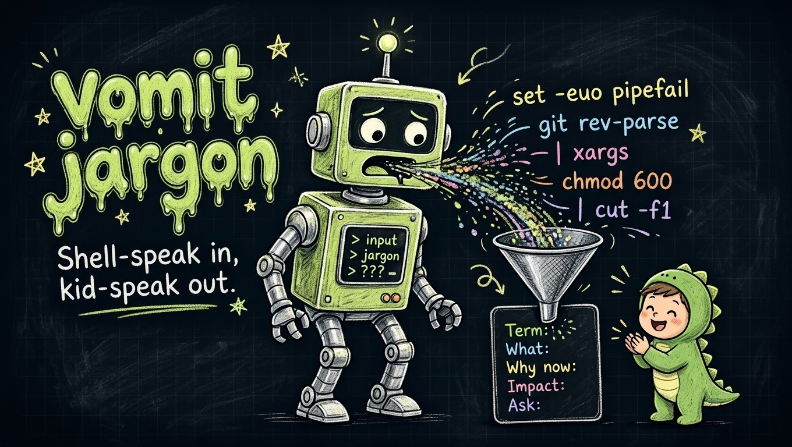
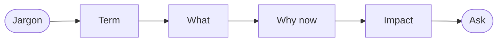

# Word Vomit Jargon

A Claude Code skill that turns your agent's jargon-heavy updates into five short, plain lines you can actually learn from. Explain-like-I'm-5 words, under 600 characters, always ending in one clear next step.

## What it does

- **Translates** a log, ticket note, status update or the agent's own last reply
- **Explains** each technical term once, with an everyday picture
- **Says what's safe**, not just what's broken
- **Ends with one ask** so you know what to do next



## Before / after

### Database lock

**Before**
> api.get_my_block_billing is STABLE but inherits a FOR UPDATE ownership check from admin.my_block, which causes lock contention in read-only transactions. Make it VOLATILE or drop the lock, then audit other STABLE callers.

**After**
> **Term:** `api.get_my_block_billing`, a database function.<br>
> **What:** It shows a building's bill and promises to only look, never touch.<br>
> **Why now:** It asks for a "do not touch" sign on the row, which a look-only job can't hold.<br>
> **Impact:** It fails every time; landlords miss renewal dates. No data lost.<br>
> **Ask:** Give it a look-only ownership check.

### Security alerts

**Before**
> Dependabot flagged 8 vulns: 6 in devalue (transitive via SvelteKit, fix in PR #24), 1 each in source-map-js and cookie (devDependencies, no patch yet). Prod bundle not exposed.

**After**
> **Term:** 8 Dependabot alerts (GitHub's robot that spots risky code libraries).<br>
> **What:** Borrowed code bits our website is built from have known weak spots.<br>
> **Why now:** Six are in one bit called `devalue`; two are tools used only while building.<br>
> **Impact:** Visitors never touch that code. The live site is safe.<br>
> **Ask:** Merge PR #24, then update the other two by hand.

### Full disk

**Before**
> Root FS at 97% due to Docker build cache and dangling layers; builds failing with ENOSPC. Recommend scoped builder prune and relocating data-root.

**After**
> **Term:** The computer's main disk.<br>
> **What:** It's like a closet; Docker (a tool that builds apps in boxes) keeps leftover boxes there.<br>
> **Why now:** The closet is 97% full, so new builds fail with "no space left".<br>
> **Impact:** New builds stop. Running apps and saved files are fine.<br>
> **Ask:** Clear out Docker's old build leftovers.

## Install

```bash
mkdir -p ~/.claude/skills/word-vomit-jargon
cp SKILL.md ~/.claude/skills/word-vomit-jargon/SKILL.md
```

Start a new Claude Code session to pick it up.

## Usage

Type `/word-vomit-jargon` or `/wvj`, or say "word vomit jargon" or "you're doing the jargon again". With no text after it, the skill rewrites the agent's last reply. It also loads on its own when the agent gives you status, findings or a decision.

## Requirements

- [Claude Code](https://claude.ai/code) with skills enabled

## License

[MIT](LICENSE)

---

Built by **Jerry Reinitz** · [github.com/JR91387](https://github.com/JR91387) · [jerryreinitz.com](https://jerryreinitz.com)<br>
Midwest AI and software engineer who builds for people, not for checkboxes.

---

**More from Reinitz Industries:** [/bruh](https://github.com/JR91387/claude-skill-bruh) · [/bully](https://github.com/JR91387/claude-skill-bully) · [Job-o-Matic](https://github.com/JR91387/jobomatic-reusme-skills-database) · [Preen](https://github.com/JR91387/Preen-AI-email-sorting) · [Calendar Forge](https://github.com/JR91387/calendar-forge-ics)
