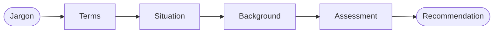

# Word Vomit Jargon

An AI agent skill that turns your agent's jargon-heavy updates into T-SBAR: five short, plain lines you can actually learn from. Explain-like-I'm-5 words, under 600 characters, always ending in one clear next step. Works with any AI that reads Markdown instructions.

## What it does

- **Reroutes** the agent to be curious and humble: if you didn't get it, it explained it badly
- **Translates** a log, ticket note, status update or the agent's own last reply
- **Explains** up to three key terms once, each with an everyday picture
- **Says what's safe**, not just what's broken
- **Ends with one recommendation** so you know what to do next



## Before / after

### Database lock

**Before**
> api.get_my_block_billing is STABLE but inherits a FOR UPDATE ownership check from admin.my_block, which causes lock contention in read-only transactions. Make it VOLATILE or drop the lock, then audit other STABLE callers.

**After**
> **Terms:** `api.get_my_block_billing`, a database function · a lock, a "do not touch" sign on a row.<br>
> **Situation:** It shows a building's bill and promises to only look, never touch.<br>
> **Background:** It asks for a lock anyway, which a look-only job can't hold.<br>
> **Assessment:** It fails every time; landlords miss renewal dates. No data lost.<br>
> **Recommendation:** Give it a look-only ownership check.

### Security alerts

**Before**
> Dependabot flagged 8 vulns: 6 in devalue (transitive via SvelteKit, fix in PR #24), 1 each in source-map-js and cookie (devDependencies, no patch yet). Prod bundle not exposed.

**After**
> **Terms:** Dependabot, GitHub's robot that spots risky code libraries · `devalue`, one of those libraries.<br>
> **Situation:** 8 alerts: borrowed code our website is built from has known weak spots.<br>
> **Background:** Six are in `devalue`; two are tools used only while building.<br>
> **Assessment:** Visitors never touch that code. The live site is safe.<br>
> **Recommendation:** Merge PR #24, then update the other two by hand.

### Full disk

**Before**
> Root FS at 97% due to Docker build cache and dangling layers; builds failing with ENOSPC. Recommend scoped builder prune and relocating data-root.

**After**
> **Terms:** main disk, the computer's closet · Docker, a tool that builds apps in boxes.<br>
> **Situation:** Docker keeps its leftover boxes in the closet.<br>
> **Background:** The closet is 97% full, so new builds fail with "no space left".<br>
> **Assessment:** New builds stop. Running apps and saved files are fine.<br>
> **Recommendation:** Clear out Docker's old build leftovers.

## Install

`SKILL.md` follows the open [Agent Skills](https://agentskills.io/specification) format: a standard front matter block (`name`, `description`, `license`, `compatibility`, `metadata`) and plain Markdown.

**Agents that support Agent Skills** (Claude Code shown; others use their own skills folder):

```bash
mkdir -p ~/.claude/skills/word-vomit-jargon
cp SKILL.md ~/.claude/skills/word-vomit-jargon/SKILL.md
```

Start a new session to pick it up.

**Any other AI assistant:** paste the contents of `SKILL.md` into its custom instructions, system prompt or project instructions.

## Usage

Say "word vomit jargon", "/wvj" or "you're doing the jargon again". With no text after it, the skill rewrites the agent's last reply. Agents that load skills automatically also use it when they give you status, findings or a decision.

## Requirements

- Any AI agent or chat assistant that follows Markdown instructions. No tools needed.

## License

[MIT](LICENSE)

---

Built by **Jerry Reinitz** · [github.com/JR91387](https://github.com/JR91387) · [jerryreinitz.com](https://jerryreinitz.com)<br>
Midwest AI and software engineer who builds for people, not for checkboxes.

---

**More from Reinitz Industries:** [/bruh](https://github.com/JR91387/claude-skill-bruh) · [/bully](https://github.com/JR91387/claude-skill-bully) · [Job-o-Matic](https://github.com/JR91387/jobomatic-reusme-skills-database) · [Preen](https://github.com/JR91387/Preen-AI-email-sorting) · [Calendar Forge](https://github.com/JR91387/calendar-forge-ics)
